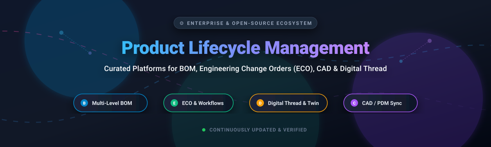

# Awesome Product Lifecycle Management (PLM)

  
  
  
  
  

> 🚀 **A curated directory of leading Product Lifecycle Management (PLM), Product Data Management (PDM), and Bill of Materials (BOM) platforms** — covering enterprise cloud SaaS suites and self-hosted open-source software solutions for hardware engineers, manufacturing teams, and product managers.
>
> 🌟 **Star this repository** if you find it helpful for your engineering architecture or PLM software evaluation!

---

## 🔍 Key Capabilities & PLM Evaluation Criteria

When evaluating Product Lifecycle Management platforms, organizations look across several mission-critical pillars:
- **Bill of Materials (BOM) Management:** Multi-level EBOM (Engineering BOM), MBOM (Manufacturing BOM), and SBOM (Service BOM) transformation with part lifecycle enforcement.
- **Engineering Change Management (ECM / ECO):** Engineering Change Requests (ECR), Engineering Change Orders (ECO), redlining, and branch-level impact analysis.
- **CAD & EDA Integrations:** Direct bidirectional integration with mechanical CAD (Creo, SolidWorks, CATIA, NX, Inventor, FreeCAD) and electronic CAD (Altium, KiCad, Eagle).
- **Digital Thread & Digital Twin:** End-to-end traceability from requirements and compliance to shop-floor manufacturing execution systems (MES) and enterprise resource planning (ERP).
- **Quality & Regulatory Compliance:** CAPA (Corrective and Preventive Action), FMEA, RoHS/REACH compliance, and audit trail maintenance.

---

## 📋 Table of Contents

- [Key Capabilities & PLM Evaluation Criteria](#-key-capabilities--plm-evaluation-criteria)
- [Sector Overview & Market Dynamics](#-sector-overview--market-dynamics)
- [SaaS / Hosted Platforms](#-saas--hosted-platforms)
- [Open-Source Software](#-open-source-software)
  - [Odoo PLM](#odoo-plm)
  - [FreeCAD](#freecad)
  - [InvenTree](#inventree)
  - [Part-DB](#part-db)
  - [DocDokuPLM](#docdokuplm)
  - [GitPLM](#gitplm)
  - [PLMore](#plmore)
  - [openPLM](#openplm)
  - [Dokuly](#dokuly)
  - [Cascadia PLM](#cascadia-plm)
  - [Innovator.Client (Aras Community)](#innovatorclient-aras-community)
  - [beCPG](#becpg)
  - [plm-rs](#plm-rs)
  - [TurboPLM](#turboplm)
  - [Kosha](#kosha)
  - [FreeBOM](#freebom)
- [Comparison at a Glance](#-comparison-at-a-glance)
- [Contributing](#-contributing)

---

## 🌐 Sector Overview & Market Dynamics

The global Product Lifecycle Management (PLM) market is estimated at **$48B to $52B** (with the broader digital manufacturing and engineering software ecosystem surpassing **$88B**), growing at a compound annual growth rate (CAGR) of ~7–10%. The sector features a **moderately concentrated oligopoly at the top**—dominated by legacy enterprise titans like Siemens, Dassault Systèmes, PTC, Oracle, and Autodesk who command Fortune 500 aerospace, automotive, and heavy industrial accounts—paired with a **fragmented long-tail** of specialized, vertical-specific vendors (e.g., CPG, fashion, medical devices) and open-source/developer-centric alternatives serving agile SMEs.

---

## 🟦 SaaS / Hosted Platforms

Commercial, cloud-hosted Product Lifecycle Management platforms. These are not open-source but are included as reference points for feature comparison.

| Platform | Target Focus | Company Size (Revenue / Valuation) | Pricing (Starting Tier) | Free Tier / Trial Limit |
|---|---|---|---|---|
| **Oracle Agile PLM (Fusion Cloud PLM)** | Legacy & cloud PLM for discrete manufacturing & supply chains | ~$57.4B Revenue (FY2025) / ~$460B+ Market Cap | $6,545/Application User (one-time perpetual license + $1,439.90/yr annual support for Agile Product Collaboration module) | No free trial for Agile PLM application; 30-day trial ($300 cloud credits) for general Oracle Cloud Infrastructure |
| **Siemens Teamcenter (Teamcenter X)** | Enterprise PLM for discrete manufacturing & global engineering | ~€75.9B (~$82B) Siemens Group Revenue / ~€140B+ Market Cap | $165/user/month (Teamcenter X Essentials, billed annually at $1,980/user/yr) | 30-day free trial with pre-configured cloud industry environments (BOM, CAD, change management) |
| **Autodesk Fusion Manage** | Cloud PLM for mid-market product development & BOM workflows | ~$6.1B Revenue (FY2025) / ~$55B–$60B Market Cap | $100/user/month (billed annually at $1,200/user/yr; Flex tokens available at 4–8 tokens/day; Contributor seats at ~$250/yr) | No self-service free trial; 30-day proof-of-concept / evaluation tenant upon request via sales |
| **Dassault ENOVIA (3DEXPERIENCE)** | Enterprise PLM deeply integrated with CATIA & SOLIDWORKS | ~€6.0B (~$6.7B) Revenue (FY2024) / ~$38B–$42B Market Cap | $115/user/month ($345/user/quarter for 3DSwymer/platform collaboration roles; ~$2,900+/user/yr for core governance/PLM) | No open self-service free trial; vendor-assisted sales proof-of-concept (PoC) & 3-month structured Drive-to-Trial programs |
| **PTC Windchill (Windchill+)** | Enterprise PLM with CAD & multi-CAD engineering depth | ~$2.74B Revenue (FY2025) / ~$21B Market Cap | ~$250/user/month (~$3,000/user/year for standard author seats) | No core PLM free trial; 15-day guided trial for Windchill Navigate & 30-day trial for Windchill Risk & Reliability |
| **Arena PLM (PTC)** | Cloud PLM & QMS for high-tech electronics & medical devices | Subsidiary of PTC ($2.74B rev / ~$21B cap); acquired for $715M | ~$100/user/month (Launch tier starting at ~$1,200/user/year; typical entry contract ~$10,000/yr minimum spend) | 10-day free trial (self-guided evaluation for BOM, Change, and Document Management; no credit card required) |
| **Centric Software (Centric PLM)** | Purpose-built PLM for fashion, retail, footwear, luxury & CPG | ~$120M–$235M Revenue (Subsidiary majority-owned by Dassault Systèmes) | ~$150/user/month (subscription tier based on user roles and enterprise modules; typical deployments quote annual contracts) | No free trial; interactive custom product demos and guided enterprise walkthroughs available upon request |
| **Propel Software (Propel PLM)** | Salesforce-native PLM, QMS, and PIM for commercial & engineering alignment | ~$25M–$50M Revenue / $48M+ VC Funding (Backed by Salesforce Ventures) | $73/user/month (billed annually; full PLM & QMS suites start upwards of $250/user/month or $3,000/user/yr) | No free trial; live personalized demonstrations and proof-of-concept sandbox environments upon request |

---

## 🟩 Open-Source Software

Self-hosted, community-driven Product Lifecycle Management and Product Data Management (PDM/BOM) tools, sorted by GitHub stars.

### Odoo PLM 
**Stack:** Python / PostgreSQL | **License:** LGPLv3 (Community)
Odoo's PLM suite tracks engineering revisions, engineering change orders (ECOs), and product master data directly synced with inventory, bills of materials (BoMs), routings, and shop floor work orders. While focused heavily on ERP-native manufacturing, it is an exceptionally popular and turnkey solution for machine shops and hardware builders.
**Best for:** Teams and machine shops already using or planning to adopt Odoo for ERP, accounting, and inventory who want engineering change and revision management integrated out of the box.

### FreeCAD 
**Stack:** C++ / Python / Qt | **License:** LGPL-2.1
FreeCAD is the premiere open-source parametric 3D modeler with dedicated workbenches and companion extensions for Product Data Management (PDM), assembly hierarchies, and Bill of Materials (BOM) inspection. It integrates with open-source PDM servers and Git-based PLM workflows for version control of mechanical parts and assemblies.
**Best for:** Open-source hardware designers and engineers needing a fully free 3D CAD modeling suite integrated with mechanical part structures and BOM extraction.

### InvenTree 
**Stack:** Python / Django / React | **License:** MIT
InvenTree is an intuitive open-source inventory, part tracking, and multi-level Bill of Materials (BOM) management system with powerful REST API endpoints and extensive plugin architecture. Often considered the lightweight open-source companion to enterprise PLM, it manages parts, suppliers, parameter templates, assemblies, and manufacturing orders.
**Best for:** Startups, makerspaces, and hardware engineering teams requiring lightweight part lifecycle and BOM management without heavy enterprise PLM administrative overhead.

### Part-DB 
**Stack:** PHP / Symfony / Vue.js | **License:** AGPLv3
Part-DB is a modern web-based electronic component and inventory management system designed for hardware makers and electrical engineering labs. It supports hierarchical categories, multi-level BOM creation, datasheet attachments, footprint tracking, and barcode/QR scanning.
**Best for:** Electronics design and hardware labs needing structured component inventory, supplier pricing tracking, and BOM management.

### DocDokuPLM 
**Stack:** Java / Docker / Cloud-Native | **License:** AGPLv3
DocDokuPLM is an enterprise-grade, cloud-native open-source PLM platform engineered for Docker and Kubernetes deployments. It features document management with full revision control, product breakdown structure (PBS), configurable Bill of Materials (effectivities, alternatives, substitutes), change workflows, and a WebGL-based browser 3D CAD visualizer.
**Best for:** Manufacturing enterprises looking for a modular, cloud-native open-source PLM with rich CAD visualization and strict engineering change workflows.

### GitPLM 
**Stack:** Git / CLI / Python | **License:** Open Source
GitPLM is an open-source PLM concept and toolset that stores manufacturing data, part numbering schemas, and BOM hierarchies in Git text formats (YAML/CSV). It brings modern software engineering practices—branching, diffing, and pull request reviews—directly to hardware development.
**Best for:** Technical hardware teams and firmware/hardware co-designers wanting Git-native version control for bills of materials and hardware releases without database setup.

### PLMore 
**Stack:** Node.js / TypeScript / Web | **License:** Open Source
PLMore is an open-source web-based PLM platform designed as an alternative to enterprise suites like Windchill and Teamcenter. It provides centralized multi-level BOM exploration, component risk assessment, lifecycle state tracking, and health diagnostics.
**Best for:** Engineering teams exploring a modern, lightweight web-based alternative to legacy enterprise PLM platforms.

### openPLM 
**Stack:** Python / Django | **License:** GPLv3
openPLM is a dedicated open-source PLM system providing core part definition, multi-level BOM structures, document revision history, and collaborative engineering workflows. It is built for discrete manufacturers seeking structured traceability.
**Best for:** Small to mid-sized discrete manufacturers transitioning from spreadsheets and network drives to formal revision-controlled parts and BOMs.

### Dokuly 
**Stack:** TypeScript / Node.js / React | **License:** Open Source
Dokuly is a modern, developer-friendly open-source PLM system crafted specifically for hardware teams. It provides part lifecycle states, multi-level BOM tracking, purchase order generation, supplier integration APIs (DigiKey, Mouser), and document control.
**Best for:** Fast-moving hardware startups looking for an open-source PLM with active component sourcing and BOM management.

### Cascadia PLM 
**Stack:** TypeScript / Next.js / PostgreSQL | **License:** AGPLv3
Cascadia is a modern, code-first Digital Thread and PLM application designed to replace legacy low-code platforms. It provides ECO-as-branch change management, enforced part lifecycles, CAD/STEP file parsing, digital twin records, and unified item modeling via declarative TypeScript configurations.
**Best for:** Modern hardware engineering organizations seeking an API-driven digital thread with Git-like branch-and-merge ECO change management.

### Innovator.Client (Aras Community) 
**Stack:** C# / .NET | **License:** MIT
The most widely starred open-source community development framework for Aras Innovator (the prominent enterprise open-core PLM suite). Provides modern async .NET client libraries, AML querying, and automated test utilities to extend Aras Innovator community instances.
**Best for:** Developers and enterprise teams extending and integrating Aras Innovator PLM with external databases, ERPs, and automated build pipelines.

### beCPG 
**Stack:** Java 21 / Spring / Alfresco / Solr / PostgreSQL | **License:** LGPLv3
beCPG is an all-in-one open-source PLM specifically designed for **food, beverage, and cosmetics** manufacturers. It features deterministic calculation engines for nutritional tables, ingredient declarations, packaging specs, allergen tracking, and regulatory compliance.
**Best for:** Food, cosmetics, and formulation-based process manufacturers needing out-of-the-box regulatory and labeling automation.

### plm-rs 
**Stack:** Rust / CLI | **License:** MIT
plm-rs is a blazingly fast Rust CLI tool for BOM parsing, schematic import (Eagle, KiCad), shortage tracking, and component lifecycle management.
**Best for:** Embedded and electrical engineers wanting a lightning-fast local CLI tool for BOM verification and inventory shortages.

### TurboPLM 
**Stack:** TypeScript / React / Node.js | **License:** MIT
TurboPLM is an open-source hardware lifecycle management tool featuring multi-level BOMs, enforced part revision states, engineering change orders, and in-browser 3D CAD visualization.
**Best for:** Hardware teams looking for a lightweight, modern web interface for part revisions and BOM exploration.

### Kosha 
**Stack:** Python / Vue.js / Linux | **License:** Open Source
Kosha is a self-hosted open-source PLM and PDM for engineering companies, featuring multi-level BOMs, CAD file revision control, change management, and ERP connectors (ERPNext, Odoo).
**Best for:** Engineering firms wanting a lightweight Linux-hosted PDM/PLM system with direct open ERP integration.

### FreeBOM 
**Stack:** JavaScript / Node.js | **License:** MIT
FreeBOM is an open-source component for managing multi-level Bills of Materials (BOM), designed for straightforward embedding inside custom PDM or PLM software.
**Best for:** Developers building bespoke internal manufacturing tools needing an open-source BOM data component.

---

## 📊 Comparison at a Glance

| Software | License | Stack | BOM/Change | CAD Integration | Industry Focus | Self-Hosted | Best For |
|---|---|---|---|---|---|---|---|
| **Siemens Teamcenter** | Proprietary | Cloud/On-prem | ✅ Deep | ✅ Broad | Discrete manufacturing | (On-prem) | Enterprise global PLM |
| **PTC Windchill** | Proprietary | Cloud/On-prem | ✅ | ✅ Creo/Multi | Discrete manufacturing | (On-prem) | CAD-integrated enterprise |
| **Dassault ENOVIA** | Proprietary | Cloud/On-prem | ✅ | ✅ CATIA/SolidWorks | Complex industrial | (On-prem) | 3DEXPERIENCE ecosystem |
| **Autodesk Fusion Manage** | Proprietary | Cloud | ✅ | ✅ Autodesk/Multi | Mid-market discrete | ❌ (Cloud) | Cloud BOM & quality workflows |
| **Arena PLM** | Proprietary | Cloud | ✅ | ✅ ECAD/MCAD | High-tech & medical | ❌ (Cloud) | Fast-setup high-tech & QMS |
| **Odoo PLM** | LGPLv3 | Python/Postgres | ✅ | (Connectors) | Discrete & assembly | ✅ | ERP-integrated PLM |
| **FreeCAD** | LGPL-2.1 | C++/Python | ✅ Workbenches | ✅ Native | Mechanical & hardware | ✅ | Parametric 3D CAD + PDM |
| **InvenTree** | MIT | Python/Django | ✅ Simple BoM | (API/Plugins) | Electronics & hardware | ✅ | Parts, BOMs & inventory |
| **DocDokuPLM** | AGPLv3 | Java/Cloud-native | ✅ Full | ✅ WebGL Viewer | General discrete | ✅ | Cloud-native modular PLM |
| **Cascadia PLM** | AGPLv3 | TypeScript/Postgres | ✅ ECO branches | ✅ 3D/STEP Viewer | Hardware engineering | ✅ | Code-first digital thread |
| **Dokuly** | Open Source | TypeScript/React | ✅ Full | (APIs) | Hardware startups | ✅ | Modern hardware BOM & sourcing |
| **GitPLM** | Open Source | Git/CLI | ✅ Git-based | (File-based) | General | ✅ (Git) | Git-native product data |
| **PLMore** | Open Source | TypeScript/Web | ✅ | (Check) | General discrete | ✅ | Web-based open PLM |
| **openPLM** | GPLv3 | Python/Django | ✅ | (Check) | Small discrete | ✅ | Lightweight parts & BOM |
| **beCPG** | LGPLv3 | Java/Spring | ✅ Recipe/BOM | ❌ | Food, cosmetics & CPG | ✅ | Regulatory & formulation PLM |

---

## 🤝 Contributing

Contributions are welcome! If you know of an open-source Product Lifecycle Management (PLM) tool that should be listed here, please open a pull request with:

- Project name and URL
- Brief description (1–2 sentences)
- Stack and license
- Why it stands out

Please ensure the project is actively maintained (releases within the last 12 months) and genuinely open-source. Note that the open-source ecosystem **splits** between **industry-specific PLM** (beCPG for food/cosmetics with deterministic regulatory engines [citation:10]), **open-core enterprise platforms** (Aras Innovator with CMII-certified change management and no license fees [citation:4]), **modern digital thread applications** (Cascadia with ECO branches and physical part traceability [citation:5]), and **lightweight part/BOM managers** (InvenTree, OpenPLM [citation:11]). **beCPG** and **Aras Innovator** represent the two strongest open-source foundations for production use in their respective domains, while **Cascadia** is a notable modern entrant for hardware teams wanting a self-hosted digital thread.

---

## 📄 License

This list is released under CC0 1.0 Universal (Public Domain). The software projects listed retain their respective licenses.

---

⭐ **If this list helped you discover a useful tool, please star the repo!** ⭐
